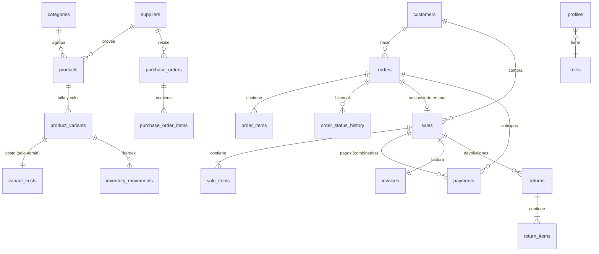

# Kary Fashion · Base de datos (Fase 2)

Esquema PostgreSQL para Supabase: tablas, relaciones, reglas de negocio, seguridad por roles y reportes.

```
supabase/
├── migrations/
│   ├── 20261111000100_core_schema.sql           tablas, tipos, restricciones e índices
│   ├── 20261111000200_business_functions.sql    ventas, compras, pedidos, devoluciones (atómicas)
│   ├── 20261111000300_security.sql              permisos, Row Level Security, vistas sin costos
│   └── 20261111000400_audit_and_reporting.sql   auditoría, inmutabilidad y reportes del dashboard
├── seed.sql                                     catálogo de DEMOSTRACIÓN (solo desarrollo)
└── tests/
    ├── 00_local_supabase_shim.sql               simula Supabase en PostgreSQL local
    ├── 10_business_rules.sql                    71 pruebas de negocio y seguridad
    └── run.sh                                   base limpia + migraciones + seed + pruebas
```

## Modelo de datos



Decisiones clave:

- **Pedido ≠ venta.** El pedido es la intención (online, WhatsApp, encargo). Al entregarse se convierte en **una sola** venta (`sales.order_id` es único), así el ingreso nunca se cuenta dos veces.
- **Variantes.** Cada talla/color tiene su propio SKU, precio y existencia.
- **Montos en centavos** (`bigint`), sin errores de redondeo.
- **Costo promedio ponderado.** Al recibir una compra, el transporte y otros costos se reparten según el valor de cada artículo y se mezclan con el costo de lo que ya había.
- **La existencia solo cambia por movimientos** (compra, venta, devolución, ajuste, anulación). Un trigger impide editarla a mano y una prueba verifica que siempre coincide con la suma del kardex.
- **Nada financiero se borra.** Las ventas se anulan, las devoluciones se registran y el kardex y la auditoría no se pueden modificar (ni siquiera con permisos de superusuario).
- **ITBIS opcional.** Desactivado por defecto (`settings.tax.charges_itbis`). Se activa cuando el negocio tenga RNC y esté registrado.
- **NCF / e-CF.** Las facturas comerciales siempre están disponibles. Un NCF solo se emite si la dueña cargó una secuencia autorizada por la DGII. Los e-CF quedan `pending_authorization` hasta integrarse con la DGII o con un proveedor certificado: el sistema nunca los da por válidos.

## Roles y permisos

| Acción | Dueña | Administradora | Empleada | Clienta | Visitante |
|---|:-:|:-:|:-:|:-:|:-:|
| Ver catálogo publicado | ✔ | ✔ | ✔ | ✔ | ✔ |
| Vender, crear pedidos, cobrar abonos | ✔ | ✔ | ✔ | – | – |
| Dar descuentos | sin límite | sin límite | hasta 10% | – | – |
| Ver costos, ganancias, gastos, proveedores, kardex | ✔ | ✔ | – | – | – |
| Crear/editar productos y precios | ✔ | ✔ | – | – | – |
| Compras, ajustes de inventario | ✔ | ✔ | – | – | – |
| Anular ventas, devoluciones, reembolsos | ✔ | ✔ | – | – | – |
| Reportes y estado de resultados | ✔ | ✔ | – | – | – |
| Asignar roles, configuración, comprobantes fiscales | ✔ | – | – | – | – |
| Ver sus propios pedidos y datos | ✔ | ✔ | ✔ | ✔ | – |

Los permisos se aplican **en la base de datos** (Row Level Security + funciones que validan el rol). Aunque alguien modifique la página o use la API directamente, no puede saltárselos.

## Funciones disponibles para la aplicación (`supabase.rpc(...)`)

| Función | Quién | Qué hace |
|---|---|---|
| `register_sale(jsonb)` | personal | Venta con descuentos, pago combinado, cambio, factura/NCF |
| `cancel_sale(id, motivo)` | admin | Anula, devuelve mercancía y marca pagos como reembolsados |
| `register_return(id, items, motivo, método)` | admin | Devolución parcial/total con reembolso |
| `receive_purchase_order(id)` | admin | Recibe compra: existencia + costo real |
| `adjust_stock(variante, cantidad, motivo)` | admin | Ajuste por conteo físico |
| `create_order(jsonb)` | personal | Pedido; los encargos exigen anticipo mínimo (50%) |
| `add_order_payment(...)` | personal | Abono a un pedido (no excede el balance) |
| `change_order_status(...)` | personal | Cambio de estado según las transiciones permitidas |
| `complete_order(id, pagos, efectivo)` | personal | Cobra el balance, factura y marca entregado |
| `set_user_role(usuario, rol)` | dueña | Da o quita acceso al personal |
| `income_statement(desde, hasta)` | admin | Estado de resultados (alimenta el dashboard) |
| `sales_series`, `top_products`, `inventory_valuation` | admin | Gráficos y rankings |

## Probar localmente

```bash
# Requiere PostgreSQL 15 o superior y un usuario con permiso para crear bases
bash supabase/tests/run.sh
```

## Puesta en marcha en Supabase

1. Crear un proyecto en [supabase.com](https://supabase.com), región **East US** (la más cercana a RD).
2. Aplicar las migraciones: `supabase link` y luego `supabase db push` (CLI), o pegar los 4 archivos en orden en el editor SQL.
3. **No** cargar `seed.sql` en producción.
4. En *Authentication*, desactivar los registros abiertos mientras no exista la tienda online, y activar la confirmación de correo.
5. Kary crea su cuenta e inicia sesión una vez. Luego, en el editor SQL, por única vez:
   ```sql
   update public.profiles set role = 'owner'
   where id = (select id from auth.users where email = 'correo-de-kary@ejemplo.com');
   ```
   Desde ahí, ella misma asigna administradoras y empleadas con `set_user_role`; la pantalla para hacerlo llega en la Fase 6.
6. Respaldos: el plan Pro incluye copias diarias automáticas. Como respaldo adicional se puede programar `pg_dump` semanal a otro almacenamiento.
